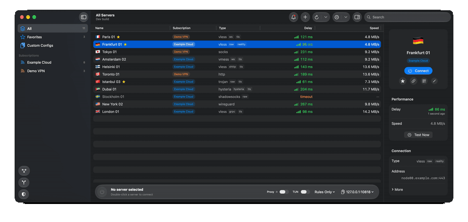
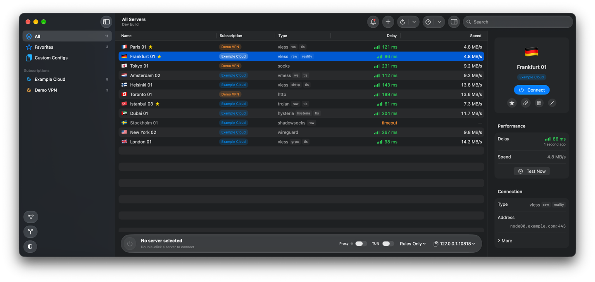
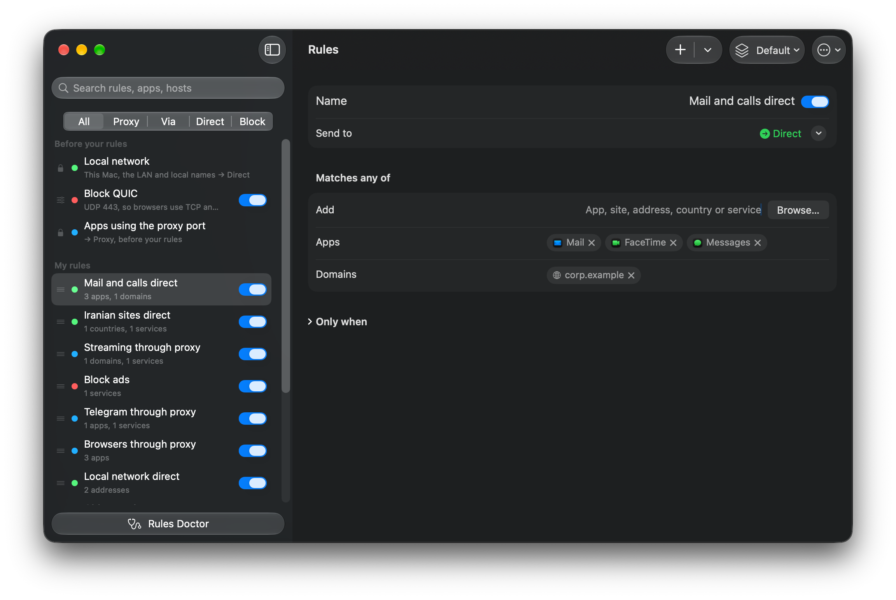
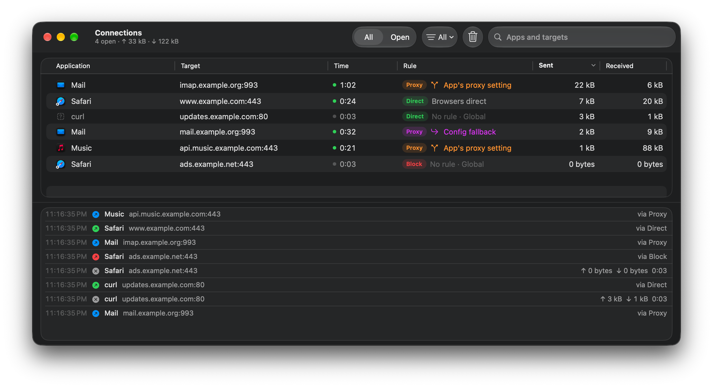
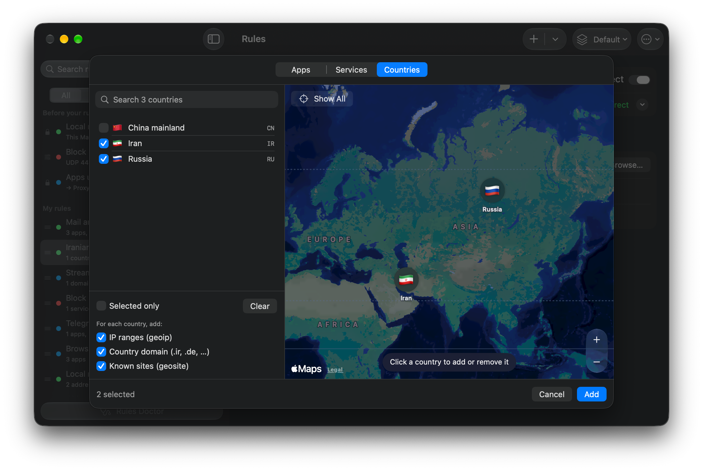
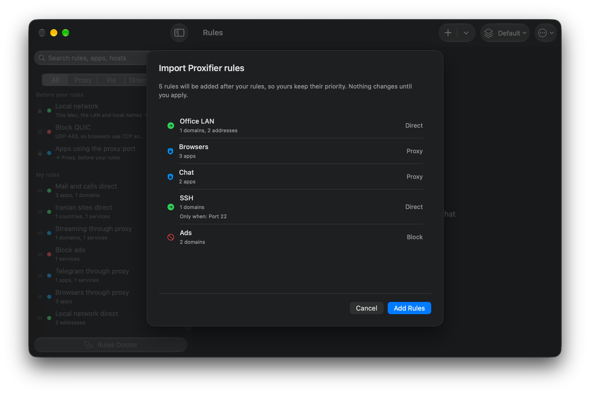

<p align="center"></p>

<h1 align="center">V2Mac</h1>

<p align="center"><b>Ein nativer macOS-Client für Xray-core und V2Ray.</b><br>
VLESS, REALITY, VMess, Trojan, Shadowsocks, Hysteria2 und WireGuard in einer schnellen SwiftUI-Menüleisten-App für Apple Silicon.</p>

<p align="center">
  <a href="https://github.com/v2macapp/v2mac/releases/latest"></a>
  <a href="https://github.com/v2macapp/v2mac/releases"></a>
  <a href="https://github.com/v2macapp/v2mac/actions/workflows/ci.yml"></a>
  
  
  
  <a href="LICENSE"></a>
  <a href="https://github.com/v2macapp/v2mac/stargazers"></a>
</p>

<p align="center"><a href="README.md">English</a> | <a href="README.fa.md">فارسی</a> | <a href="README.zh.md">简体中文</a> | <a href="README.zh-Hant.md">繁體中文</a> | <a href="README.ru.md">Русский</a> | Deutsch</p>

<p align="center">
  <a href="#installation">Installation</a> ·
  <a href="#funktionen">Funktionen</a> ·
  <a href="https://v2macapp.github.io/de/"><b>Website</b></a> ·
  <a href="https://github.com/v2macapp/v2mac/wiki/de-Home"><b>Dokumentation</b></a> ·
  <a href="#aus-dem-quellcode-erstellen">Erstellen</a>
</p>

<p align="center"></p>

Fügen Sie einen Abonnementlink ein und wählen Sie einen Server, um einen lokalen SOCKS5- und HTTP-Proxy zu erhalten. Oder aktivieren Sie TUN, um den gesamten Mac darüber zu leiten. V2Mac ist eine kostenlose **v2rayN-/V2RayX-Alternative für macOS** mit offenem Quellcode, nativ in SwiftUI mit Liquid Glass entwickelt. Ohne Electron, Nutzungsanalyse oder Telemetrie.

## Installation

Benötigt **macOS 26 oder neuer** auf **Apple Silicon**.

```sh
brew install --cask v2macapp/tap/v2mac
```

Oder laden Sie das DMG der [neuesten Version](https://github.com/v2macapp/v2mac/releases/latest). Es ist nicht notarisiert: Klicken Sie beim ersten Start unter Systemeinstellungen → Datenschutz & Sicherheit auf **Dennoch öffnen**. Einzelheiten stehen in der [Installationsanleitung](https://github.com/v2macapp/v2mac/wiki/de-Installation). Danach aktualisiert sich V2Mac selbst: Es lädt nur geänderte Dateien herunter und installiert sie beim Beenden.

**Schnellstart:** Klicken Sie auf **Abonnement hinzufügen**, fügen Sie Ihren Link ein und doppelklicken Sie auf einen Server. Verwenden Sie dann `127.0.0.1:10808` (SOCKS5 / HTTP) oder aktivieren Sie **System-Proxy** oder **TUN**.

## Funktionen

- **Protokolle:** VLESS (REALITY, XTLS Vision), VMess, Trojan, Shadowsocks, Hysteria2, WireGuard, SOCKS, HTTP und vollständige Xray-JSON-Konfigurationen.
- **Abonnements:** automatische Updates, Verbrauch und Ablaufdatum, Favoriten, QR- und Ein-Klick-Import sowie vollständiger Servereditor.
- **Verbindung:** tatsächliche Latenz- und Geschwindigkeitstests, automatische Serverauswahl, Wechsel ohne Neustart und Ausgangsland in der Menüleiste.
- **Modi für den ganzen Mac:** TUN, System-Proxy und pf-basierter Kill Switch.
- **Routing:** Global, Regionen umgehen (Iran, China, Russland), Nur Regeln und Direkt sowie Proxy-/Direkt-/Blockierregeln nach Website und App.
- **Proxifier-Alternative:** App-Regeln mit „Nur wenn“-Bedingungen, Regeln über andere Server oder Gruppen, Import von `.ppx`-Profilen und Live-Verbindungsansicht.
- **Cloudflare WARP:** als eigener Server oder hinter Ihrem Server verkettet.
- **Sichere Sandbox (Beta):** Apps in Mini-VMs mit jeweils eigenem Server ausführen. Bei Ausfall wird blockiert, jede App erscheint als eigene Mac-App. Eine Mini-VM besteht aus Containern mit gemeinsamem Linux-Kernel innerhalb einer VM ohne Netzwerkgerät. Wird erst beim ersten Öffnen heruntergeladen.
- **macOS:** Menüleistenfenster, Kurzbefehle, Siri, Spotlight, Kontrollzentrum, Desktop-Widget, Domainvorschläge mit Apple Intelligence, Touch ID, Mitteilungen sowie Sicherung und Wiederherstellung. Mit deutscher Oberfläche.

## Bildschirmfotos

<p align="center"></p>

<table>
  <tr>
    <td align="center"><br><sub>Regeln nach App und Website</sub></td>
    <td align="center"><br><sub>Jede Verbindung und ihre Regel</sub></td>
  </tr>
  <tr>
    <td align="center"><br><sub>Länder auf der Karte</sub></td>
    <td align="center"><br><sub>Proxifier-Import</sub></td>
  </tr>
</table>

## Dokumentation

Das **[V2Mac-Wiki](https://github.com/v2macapp/v2mac/wiki/de-Home)** erklärt alle Funktionen:

| | |
|---|---|
| [Installation](https://github.com/v2macapp/v2mac/wiki/de-Installation) | Homebrew, DMG, erster Start, Updates |
| [Server und Abonnements](https://github.com/v2macapp/v2mac/wiki/de-Servers-and-Subscriptions) | Hinzufügen, Aktualisieren, Bearbeiten, Latenztests |
| [Verbinden](https://github.com/v2macapp/v2mac/wiki/de-Connecting) | TUN, System-Proxy, Kill Switch, Ausgangsprüfung, WARP |
| [Routing](https://github.com/v2macapp/v2mac/wiki/de-Routing) | Modi, Regelfenster, Weiterleitung über andere Server, Proxifier-Import |
| [Verbindungen](https://github.com/v2macapp/v2mac/wiki/de-Connections) | Live-Verbindungsliste |
| [Sichere Sandbox](https://github.com/v2macapp/v2mac/wiki/de-Sandbox) | Mini-VMs, Sandbox-Apps, Ausgänge, Store |
| [Menüleiste und Kurzbefehle](https://github.com/v2macapp/v2mac/wiki/de-Menu-Bar-and-Shortcuts) | Fenster, Tastatur, Kurzbefehle, Mitteilungen |
| [Einstellungsreferenz](https://github.com/v2macapp/v2mac/wiki/de-Settings-Reference) | Alle Einstellungen, Sicherung, Datenschutz |
| [Fehlerbehebung und FAQ](https://github.com/v2macapp/v2mac/wiki/de-Troubleshooting-and-FAQ) | Häufige Probleme und Fragen |
| [Bekannte Einschränkungen](https://github.com/v2macapp/v2mac/wiki/de-Known-Limitations) | Abdeckung und Grenzen der Modi; Sicherheitslücken melden |

Für Schutz vor Datenlecks in Chrome kombinieren Sie V2Mac mit [**noleaker**](https://github.com/v2macapp/noleaker), einer kostenlosen Erweiterung desselben Entwicklers.

## Aus dem Quellcode erstellen

```sh
Scripts/fetch-core.sh
xcodegen generate
xcodebuild -project v2mac.xcodeproj -scheme v2mac -configuration Debug build
```

Benötigt Xcode 26+ und [XcodeGen](https://github.com/yonaskolb/XcodeGen). Entwurf: [docs/SPEC.md](docs/SPEC.md). Tests: `cd Packages/V2MacCore && swift test`. Fehlerberichte und Pull Requests sind unter [Issues](https://github.com/v2macapp/v2mac/issues) willkommen.

## Lizenz

[GPL-3.0](LICENSE). Enthält [Xray-core](https://github.com/XTLS/Xray-core) (MPL-2.0); siehe [THIRD_PARTY.md](THIRD_PARTY.md).

<p align="center"><sub>Wenn V2Mac Ihnen hilft, hilft ein ⭐ anderen, es zu finden.</sub></p>
