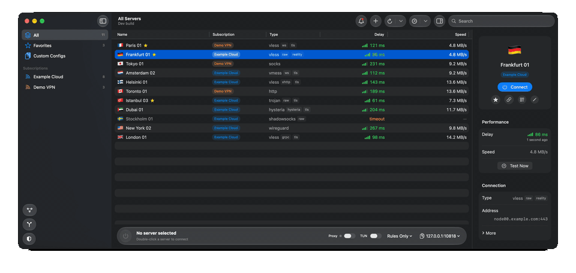
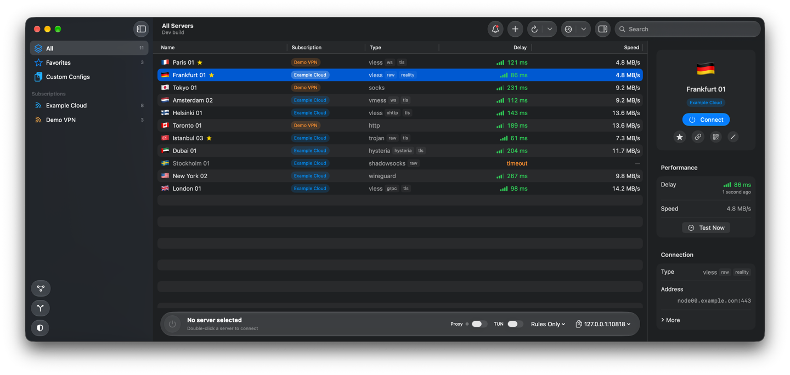
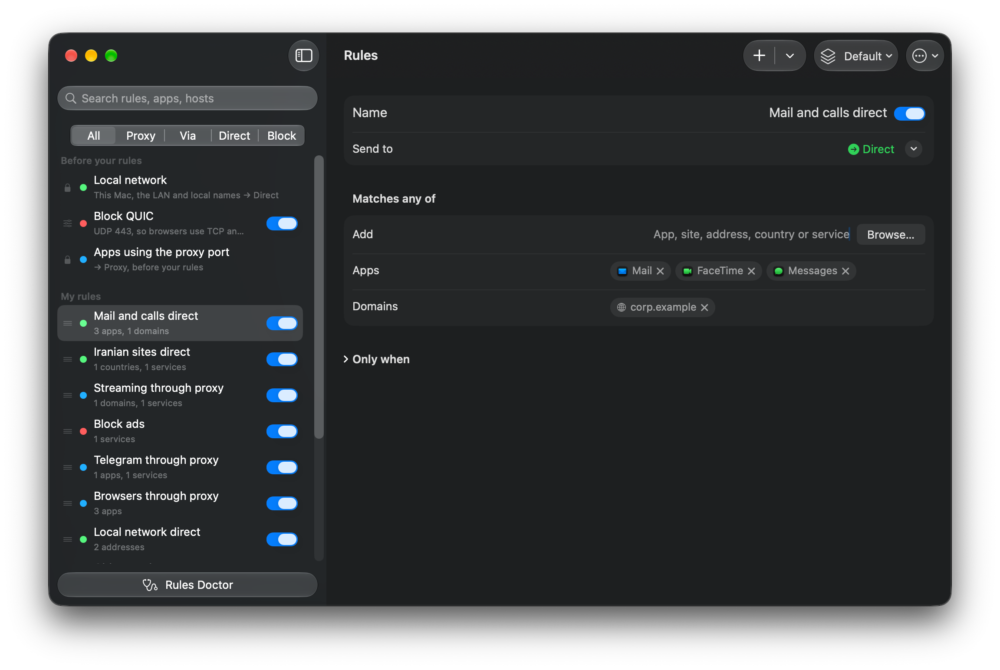
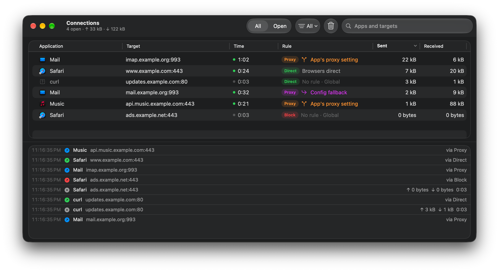
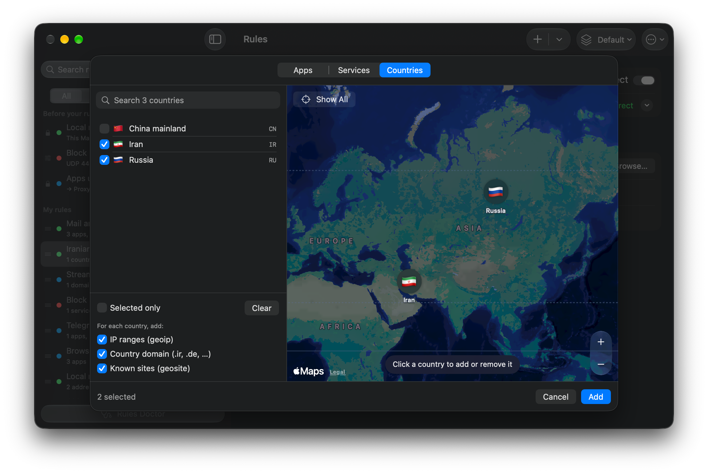
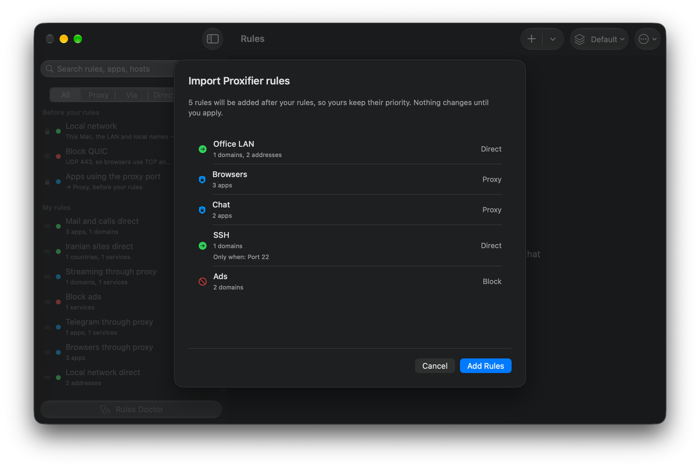

<p align="center"></p>

<h1 align="center">V2Mac</h1>

<p align="center" dir="rtl"><b>کلاینت بومی macOS برای Xray-core و V2Ray.</b><br>
VLESS، REALITY، VMess، Trojan، Shadowsocks، Hysteria2 و WireGuard در یک برنامهٔ سریع منوبار با SwiftUI برای مک‌های Apple Silicon / Intel.</p>

<p align="center">
  <a href="https://github.com/v2macapp/v2mac/releases/latest"></a>
  <a href="https://github.com/v2macapp/v2mac/releases"></a>
  <a href="https://github.com/v2macapp/v2mac/actions/workflows/ci.yml"></a>
  
  
  
  <a href="LICENSE"></a>
  <a href="https://github.com/v2macapp/v2mac/stargazers"></a>
</p>

<p align="center"><a href="https://github.com/v2macapp/v2mac/releases/latest/download/V2Mac.dmg"></a></p>
<p align="center"><a href="https://github.com/v2macapp/v2mac/releases/latest/download/V2Mac-Intel.dmg"></a></p>

<p align="center"><a href="README.md">English</a> | فارسی | <a href="README.zh.md">简体中文</a> | <a href="README.zh-Hant.md">繁體中文</a> | <a href="README.ru.md">Русский</a> | <a href="README.de.md">Deutsch</a></p>

<p align="center" dir="rtl">
  <a href="#نصب">نصب</a> ·
  <a href="#امکانات">امکانات</a> ·
  <a href="https://v2macapp.github.io"><b>وب‌سایت</b></a> ·
  <a href="https://github.com/v2macapp/v2mac/wiki/fa-Home"><b>مستندات</b></a> ·
  <a href="#ساخت-از-سورس">ساخت</a>
</p>

<p align="center"></p>

<div dir="rtl">

لینک اشتراک را وارد کنید، یک سرور انتخاب کنید و یک پروکسی محلی SOCKS5 و HTTP تحویل بگیرید، یا حالت TUN را روشن کنید تا کل مک از آن عبور کند. V2Mac یک **جایگزین رایگان و متن‌باز v2rayN و V2RayX برای macOS** است که به‌صورت بومی با SwiftUI و Liquid Glass نوشته شده. بدون Electron، بدون آمارگیری و بدون ارسال داده.

## نصب

<p align="center"><a href="https://github.com/v2macapp/v2mac/releases/latest/download/V2Mac.dmg"></a></p>
<p align="center"><a href="https://github.com/v2macapp/v2mac/releases/latest/download/V2Mac-Intel.dmg"></a></p>

<p align="center" dir="rtl"><sub>نمی‌دانید کدام؟ منوی Apple → <b>About This Mac</b>: اگر <b>Chip</b> نوشته Apple Silicon است و اگر <b>Processor</b> نوشته Intel.</sub></p>

یا با **Homebrew** نصب کنید که نسخهٔ مناسب مک شما را خودش انتخاب می‌کند:

</div>

```sh
brew install --cask v2macapp/tap/v2mac
```

<div dir="rtl">

> **توجه:** V2Mac هنوز notarize نشده و macOS اولین اجرا را مسدود می‌کند. به **System Settings → Privacy & Security** بروید و روی **Open Anyway** بزنید. جزئیات در [راهنمای نصب](https://github.com/v2macapp/v2mac/wiki/fa-Installation).

از آن به بعد V2Mac خودش را به‌روز نگه می‌دارد: فقط فایل‌های تغییرکرده را دانلود می‌کند و هنگام بستن برنامه نصب می‌کند. نسخه‌های قبلی در صفحهٔ [Releases](https://github.com/v2macapp/v2mac/releases) هستند.

### شروع سریع

1. روی **Add Subscription** بزنید و لینک خود را بچسبانید.
2. روی یک سرور دوبار کلیک کنید تا وصل شوید.
3. در برنامه‌ها از `127.0.0.1:10808` (SOCKS5 و HTTP) استفاده کنید، یا **System Proxy** یا **TUN** را روشن کنید تا کل مک از آن عبور کند.

### پیش‌نیازها

| | Apple Silicon | Intel |
|---|:---:|:---:|
| V2Mac (macOS 14 Sonoma یا جدیدتر) | ✓ | ✓ |
| جستجوی سرورها در Spotlight (macOS 15 یا جدیدتر) | ✓ | ✓ |
| Liquid Glass و مرکز کنترل (macOS 26) | ✓ | ✓ |
| پیشنهاد دامنه با Apple Intelligence (macOS 26) | ✓ | — |
| سندباکس امن (macOS 26) | ✓ | — |

در macOS 14 و 15 برنامه به‌جای Liquid Glass از کنترل‌های استاندارد استفاده می‌کند.

## امکانات

- **پروتکل‌ها:** VLESS (REALITY، XTLS Vision)، VMess، Trojan، Shadowsocks، Hysteria2، WireGuard، SOCKS، HTTP و کانفیگ کامل JSON ایکس‌ری.
- **اشتراک‌ها:** به‌روزرسانی خودکار، حجم و تاریخ انقضا، علاقه‌مندی‌ها، وارد کردن با QR و یک کلیک، ویرایشگر کامل سرور.
- **اتصال:** تست تأخیر واقعی و سرعت، انتخاب خودکار سرور، تعویض زنده بدون ری‌استارت، کشور خروجی در نوار منو.
- **کل مک:** TUN، پراکسی سیستم و کیل‌سوییچ مبتنی بر pf.
- **مسیریابی:** Global، Bypass regions (ایران، چین، روسیه)، Rules Only و Direct، به‌همراه قوانین Proxy / Direct / Block بر اساس سایت و برنامه.
- **جایگزین Proxifier:** قانون برای هر برنامه با شرط‌های «فقط وقتی»، قانون از طریق سرور یا گروهی دیگر، وارد کردن پروفایل `.ppx` و نمای زندهٔ Connections.
- **Cloudflare WARP:** به‌عنوان سرور مستقل یا زنجیرشده پشت سرور شما.
- **سندباکس امن (بتا):** اجرای برنامه‌ها در ماشین‌های مجازی کوچک، هر کدام با سرور خودش و بدون نشت در صورت قطعی؛ هر برنامه مثل یک برنامهٔ جداگانهٔ مک. فقط با اولین باز کردن دانلود می‌شود.
- **macOS:** پنل نوار منو، Shortcuts، Siri، Spotlight، Control Center، ویجت دسکتاپ، پیشنهاد دامنه با Apple Intelligence، Touch ID، اعلان‌ها، پشتیبان‌گیری و بازگردانی. رابط کاربری به ۱۳ زبان در دسترس است.

## تصاویر برنامه

</div>

<p align="center"></p>

<table>
  <tr>
    <td align="center"><br><sub>قانون برای هر برنامه و سایت</sub></td>
    <td align="center"><br><sub>هر اتصال و قانون پشت آن</sub></td>
  </tr>
  <tr>
    <td align="center"><br><sub>انتخاب کشور روی نقشه</sub></td>
    <td align="center"><br><sub>وارد کردن از Proxifier</sub></td>
  </tr>
</table>

<div dir="rtl">

## مستندات

**[ویکی V2Mac](https://github.com/v2macapp/v2mac/wiki/fa-Home)** همه چیز را با جزئیات توضیح می‌دهد:

| | |
|---|---|
| [نصب](https://github.com/v2macapp/v2mac/wiki/fa-Installation) | Homebrew، DMG، اولین اجرا، به‌روزرسانی |
| [سرورها و اشتراک‌ها](https://github.com/v2macapp/v2mac/wiki/fa-Servers-and-Subscriptions) | افزودن، به‌روزرسانی، ویرایش، تست تأخیر |
| [اتصال](https://github.com/v2macapp/v2mac/wiki/fa-Connecting) | TUN، پراکسی سیستم، کیل‌سوییچ، بررسی خروجی، WARP |
| [مسیریابی](https://github.com/v2macapp/v2mac/wiki/fa-Routing) | حالت‌ها، پنجرهٔ Rules، سرورهای Via، وارد کردن از Proxifier |
| [اتصال‌ها](https://github.com/v2macapp/v2mac/wiki/fa-Connections) | فهرست زندهٔ اتصال‌ها |
| [سندباکس امن](https://github.com/v2macapp/v2mac/wiki/fa-Sandbox) | ماشین‌های مجازی کوچک، برنامه‌های سندباکس، خروجی‌ها، فروشگاه |
| [نوار منو و میان‌برها](https://github.com/v2macapp/v2mac/wiki/fa-Menu-Bar-and-Shortcuts) | پنل، صفحه‌کلید، Shortcuts، اعلان‌ها |
| [مرجع تنظیمات](https://github.com/v2macapp/v2mac/wiki/fa-Settings-Reference) | همهٔ تنظیمات، پشتیبان‌گیری، حریم خصوصی |
| [عیب‌یابی و پرسش‌های رایج](https://github.com/v2macapp/v2mac/wiki/fa-Troubleshooting-and-FAQ) | مشکلات و پرسش‌های رایج |
| [محدودیت‌های شناخته‌شده](https://github.com/v2macapp/v2mac/wiki/fa-Known-Limitations) | هر حالت چه چیزی را پوشش می‌دهد و چه چیزی را نه؛ گزارش آسیب‌پذیری |

برای جلوگیری از نشت اطلاعات در کروم، V2Mac را همراه [**noleaker**](https://github.com/v2macapp/noleaker)، افزونهٔ رایگان همین سازنده، استفاده کنید.

## ساخت از سورس

</div>

```sh
Scripts/fetch-core.sh
xcodegen generate
xcodebuild -project v2mac.xcodeproj -scheme v2mac -configuration Debug build
```

برای ساخت Debug اینتل، هسته را با `ARCH=x86_64 Scripts/fetch-core.sh` بگیرید و `ARCHS=x86_64` را به `xcodebuild` اضافه کنید. برای ساخت DMG اینتل از `ARCH=x86_64 Scripts/make-dmg.sh` استفاده کنید.

<div dir="rtl">

به Xcode 26 به بعد و [XcodeGen](https://github.com/yonaskolb/XcodeGen) نیاز دارد. طراحی: [docs/SPEC.md](docs/SPEC.md). تست‌ها: `cd Packages/V2MacCore && swift test`. گزارش مشکل و pull request در [Issues](https://github.com/v2macapp/v2mac/issues).

## مجوز

[GPL-3.0](LICENSE). شامل [Xray-core](https://github.com/XTLS/Xray-core) (MPL-2.0)؛ [THIRD_PARTY.md](THIRD_PARTY.md) را ببینید.

</div>

<p align="center"><sub>اگر V2Mac به کارتان آمد، یک ⭐ کمک می‌کند دیگران هم پیدایش کنند.</sub></p>
