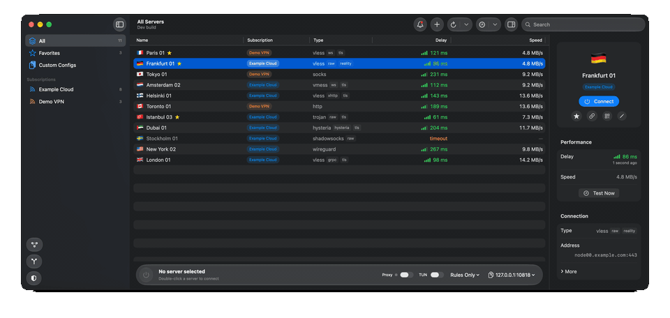
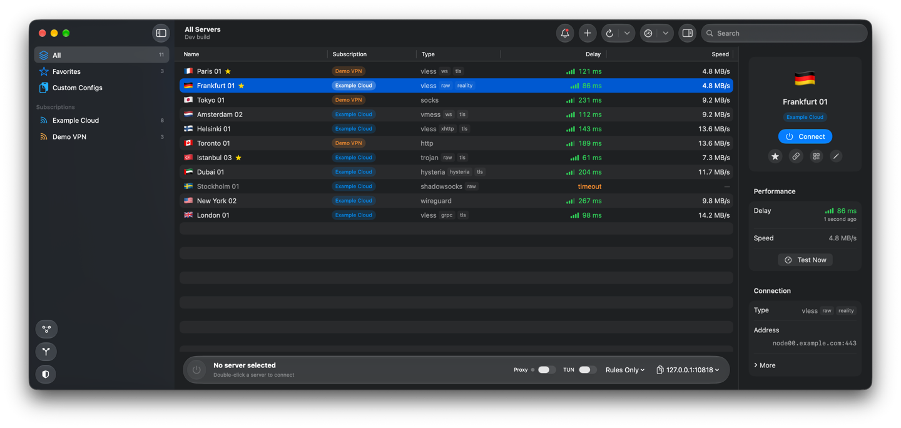
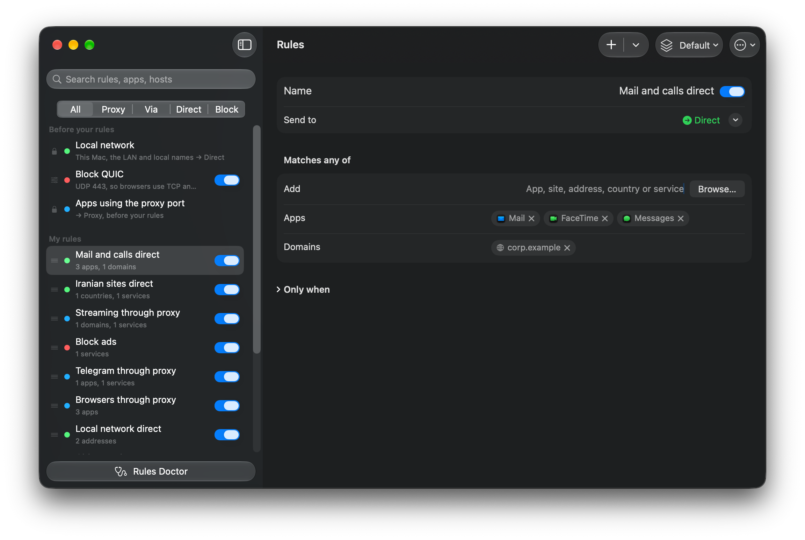
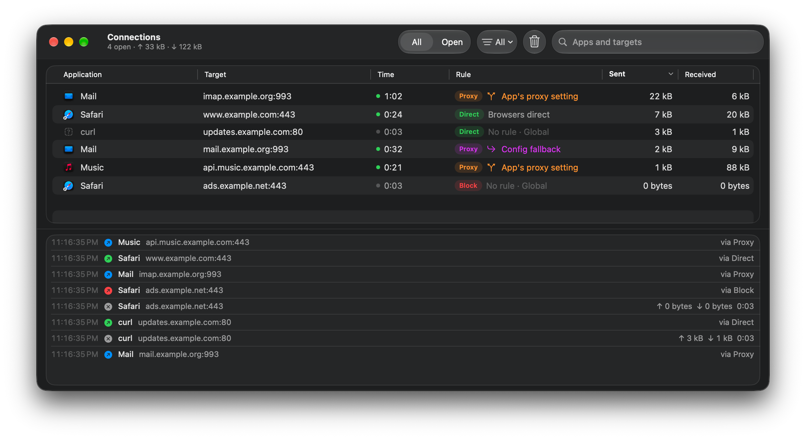
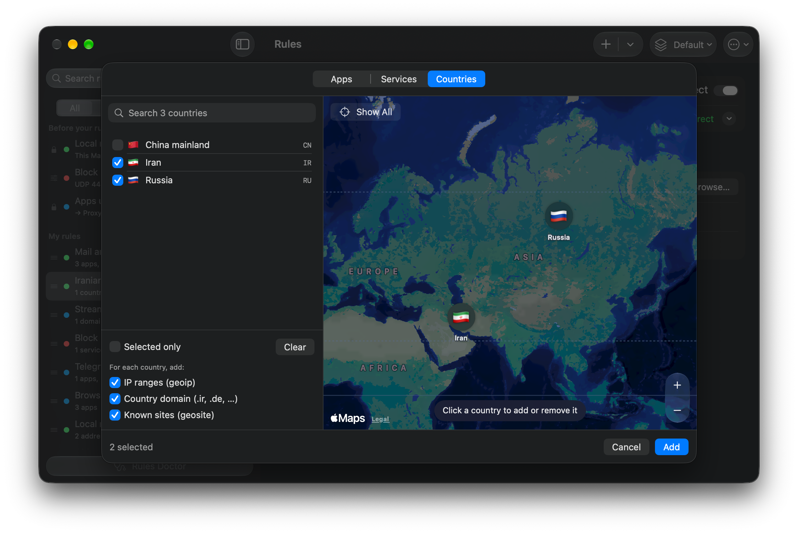
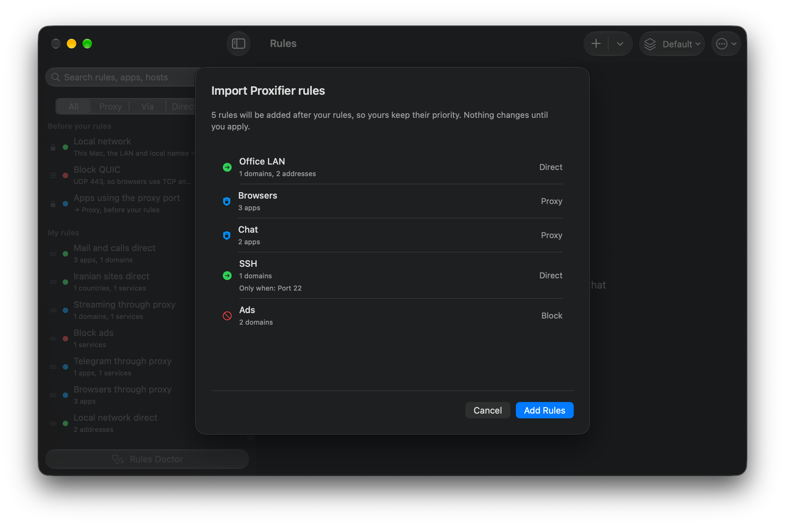

<p align="center"></p>

<h1 align="center">V2Mac</h1>

<p align="center"><b>原生 macOS Xray-core / V2Ray 客戶端。</b><br>
VLESS、REALITY、VMess、Trojan、Shadowsocks、Hysteria2 和 WireGuard，集成在一個為 Apple Silicon / Intel 打造的快速 SwiftUI 菜單欄應用中。</p>

<p align="center">
  <a href="https://github.com/v2macapp/v2mac/releases/latest"></a>
  <a href="https://github.com/v2macapp/v2mac/releases"></a>
  <a href="https://github.com/v2macapp/v2mac/actions/workflows/ci.yml"></a>
  
  
  
  <a href="LICENSE"></a>
  <a href="https://github.com/v2macapp/v2mac/stargazers"></a>
</p>

<p align="center"><a href="https://github.com/v2macapp/v2mac/releases/latest/download/V2Mac.dmg"></a> <a href="https://github.com/v2macapp/v2mac/releases/latest/download/V2Mac-Intel.dmg"></a></p>

<p align="center"><a href="README.md">English</a> | <a href="README.fa.md">فارسی</a> | <a href="README.zh.md">简体中文</a> | 繁體中文 | <a href="README.ru.md">Русский</a> | <a href="README.de.md">Deutsch</a></p>

<p align="center">
  <a href="#安裝">安裝</a> ·
  <a href="#功能">功能</a> ·
  <a href="https://v2macapp.github.io"><b>網站</b></a> ·
  <a href="https://github.com/v2macapp/v2mac/wiki/zh-Hant-Home"><b>文檔</b></a> ·
  <a href="#從源碼構建">構建</a>
</p>

<p align="center"></p>

粘貼訂閱連結、選擇伺服器，即可獲得本地 SOCKS5 + HTTP 代理；或打開 TUN 模式讓整台 Mac 走代理。V2Mac 是免費開源的 **macOS 版 v2rayN / V2RayX 替代品**，使用 SwiftUI 和 Liquid Glass 原生編寫。無 Electron、無統計分析、無遙測。

## 安裝

<p align="center"><a href="https://github.com/v2macapp/v2mac/releases/latest/download/V2Mac.dmg"></a> <a href="https://github.com/v2macapp/v2mac/releases/latest/download/V2Mac-Intel.dmg"></a></p>

<p align="center"><sub>不確定選哪個？蘋果選單 → <b>關於這台 Mac</b>：顯示<b>晶片</b>的是 Apple Silicon，顯示<b>處理器</b>的是 Intel。</sub></p>

也可以用 **Homebrew** 安裝，它會自動選擇適合你 Mac 的版本：

```sh
brew install --cask v2macapp/tap/v2mac
```

> [!NOTE]
> V2Mac 尚未經過公證，macOS 會阻擋首次啓動。打開 **系統設定 → 隱私權與安全性**，點擊 **強制打開**。詳見[安裝指南](https://github.com/v2macapp/v2mac/wiki/zh-Hant-Installation)。

之後 V2Mac 會自動保持最新：只下載有變化的檔案，並在退出時安裝。舊版本見 [Releases](https://github.com/v2macapp/v2mac/releases) 頁面。

### 快速開始

1. 點擊 **Add Subscription** 並貼上你的連結。
2. 雙擊伺服器進行連線。
3. 在應用程式中使用 `127.0.0.1:10808`（SOCKS5 和 HTTP），或打開 **System Proxy** 或 **TUN** 讓整台 Mac 走代理。

### 系統需求

| | Apple Silicon | Intel |
|---|:---:|:---:|
| V2Mac（macOS 14 Sonoma 或更高版本） | ✓ | ✓ |
| Spotlight 伺服器搜尋（macOS 15 或更高版本） | ✓ | ✓ |
| Liquid Glass 和控制中心（macOS 26） | ✓ | ✓ |
| Apple Intelligence 網域建議（macOS 26） | ✓ | — |
| 安全沙盒（macOS 26） | ✓ | — |

在 macOS 14 和 15 上，應用程式使用標準控制項代替 Liquid Glass。

## 功能

- **協議：** VLESS（REALITY、XTLS Vision）、VMess、Trojan、Shadowsocks、Hysteria2、WireGuard、SOCKS、HTTP 以及完整 Xray JSON 配置。
- **訂閱：** 自動更新、流量與到期日、收藏、二維碼和一鍵導入、完整的伺服器編輯器。
- **連線：** 真實延遲和速度測試、自動選擇伺服器、無需重啓的實時切換、菜單欄顯示出口國家。
- **全局模式：** TUN、系統代理和基於 pf 的 Kill Switch。
- **路由：** Global、Bypass regions（伊朗、中國、俄羅斯）、Rules Only 和 Direct，以及按網站和應用的 Proxy / Direct / Block 規則。
- **Proxifier 替代品：** 按應用分流並支持“僅當”條件、經由其他伺服器或分組的規則、導入 `.ppx` 配置和實時連線視圖。
- **Cloudflare WARP：** 作為獨立伺服器或串接在你的伺服器之後。
- **安全沙盒（測試版）：** 在迷你虛擬機中運行應用，每個虛擬機使用自己的伺服器，斷線即斷網，每個應用都是獨立的 Mac 應用。僅在首次打開時下載。
- **macOS 集成：** 菜單欄面板、快捷指令、Siri、Spotlight、控制中心、桌面小組件、Apple Intelligence 域名建議、Touch ID、通知、備份與恢復。介面支援 13 種語言。

## 截圖

<p align="center"></p>

<table>
  <tr>
    <td align="center"><br><sub>按應用和網站分流</sub></td>
    <td align="center"><br><sub>每個連線及其規則</sub></td>
  </tr>
  <tr>
    <td align="center"><br><sub>在地圖上選擇國家</sub></td>
    <td align="center"><br><sub>導入 Proxifier</sub></td>
  </tr>
</table>

## 文檔

**[V2Mac Wiki](https://github.com/v2macapp/v2mac/wiki/zh-Hant-Home)** 詳細介紹了所有內容：

| | |
|---|---|
| [安裝](https://github.com/v2macapp/v2mac/wiki/zh-Hant-Installation) | Homebrew、DMG、首次啓動、更新 |
| [伺服器與訂閱](https://github.com/v2macapp/v2mac/wiki/zh-Hant-Servers-and-Subscriptions) | 加入、更新、編輯、延遲測試 |
| [連線](https://github.com/v2macapp/v2mac/wiki/zh-Hant-Connecting) | TUN、系統代理、Kill Switch、出口檢測、WARP |
| [路由](https://github.com/v2macapp/v2mac/wiki/zh-Hant-Routing) | 模式、規則窗口、Via 伺服器、導入 Proxifier |
| [連線列表](https://github.com/v2macapp/v2mac/wiki/zh-Hant-Connections) | 實時連線列表 |
| [安全沙盒](https://github.com/v2macapp/v2mac/wiki/zh-Hant-Sandbox) | 迷你虛擬機、沙盒應用、出口、商店 |
| [菜單欄與快捷方式](https://github.com/v2macapp/v2mac/wiki/zh-Hant-Menu-Bar-and-Shortcuts) | 面板、鍵盤、快捷指令、通知 |
| [設定參考](https://github.com/v2macapp/v2mac/wiki/zh-Hant-Settings-Reference) | 所有設定、備份、隱私 |
| [故障排除與常見問題](https://github.com/v2macapp/v2mac/wiki/zh-Hant-Troubleshooting-and-FAQ) | 常見問題與解答 |
| [已知限制](https://github.com/v2macapp/v2mac/wiki/zh-Hant-Known-Limitations) | 每種模式覆蓋什麼、不覆蓋什麼；如何報告漏洞 |

如需在 Chrome 中防止洩漏，可搭配同一作者的免費擴展 [**noleaker**](https://github.com/v2macapp/noleaker)。

## 從源碼構建

```sh
Scripts/fetch-core.sh
xcodegen generate
xcodebuild -project v2mac.xcodeproj -scheme v2mac -configuration Debug build
```

建置 Intel Debug 版本時，用 `ARCH=x86_64 Scripts/fetch-core.sh` 取得核心，並為 `xcodebuild` 加上 `ARCHS=x86_64`。用 `ARCH=x86_64 Scripts/make-dmg.sh` 封裝 Intel DMG。

需要 Xcode 26+ 和 [XcodeGen](https://github.com/yonaskolb/XcodeGen)。設計文檔：[docs/SPEC.md](docs/SPEC.md)。測試：`cd Packages/V2MacCore && swift test`。歡迎在 [Issues](https://github.com/v2macapp/v2mac/issues) 提交問題和 PR。

## 許可證

[GPL-3.0](LICENSE)。內置 [Xray-core](https://github.com/XTLS/Xray-core)（MPL-2.0）；見 [THIRD_PARTY.md](THIRD_PARTY.md)。

<p align="center"><sub>如果 V2Mac 對你有幫助，點個 ⭐ 能讓更多人發現它。</sub></p>
